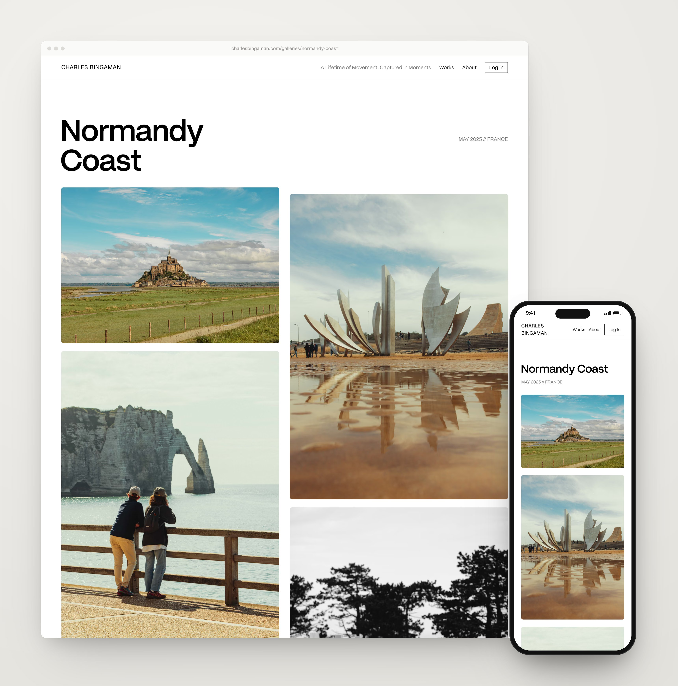

# charlesbingaman.com

**A photography portfolio, client platform and photo map in one**

**[Read the case study →](https://github.com/CB-viberrr/portfolio/blob/main/case-studies/photo-site.md)** · [Live](https://www.charlesbingaman.com)

- **A complete back office for a working photographer, with nothing they don't need:** culling, client
  delivery, proofing, inquiries and security in one admin.
- **Replaces two paid products** (SmugMug-style portfolio and Pixieset-style client delivery) on near-free infrastructure.
- **Automatic subject-aware cropping at no API cost:** 69% of crops land within a tenth of a hand-placed point, vs 18%
  for centre-cropping, at ~90 ms per photo.
- **Location-safe by design:** public precision per gallery, and GPS scrubbed in place from client downloads.

---
This repository is a showcase: the code is private. A walkthrough or read access is available on request.
More work: [portfolio](https://github.com/CB-viberrr/portfolio) · © 2026 Charles Bingaman
